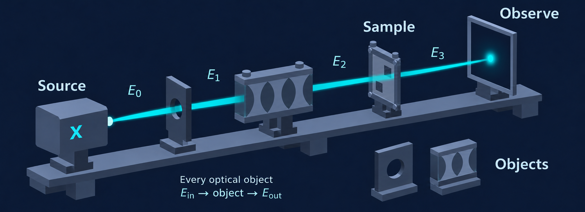

# XPOSim

[](https://pypi.org/project/XPOSim/)
[](https://pypi.org/project/XPOSim/)
[](https://github.com/mamichberdey/XPOSim/blob/main/LICENSE)
[](https://github.com/mamichberdey/XPOSim/actions/workflows/validation.yml)
[](https://colab.research.google.com/github/mamichberdey/XPOSim/blob/d83465d52d4c8d2244240a464f0bc8927dd8b390/notebooks/CRL_Focus_Colab.ipynb)

<a id="1-about-xposim"></a>

XPOSim (X-ray Paraxial Optical Simulation) models monochromatic X-ray propagation,
diffraction and focusing on 1D and 2D grids. Build schemes from sources, compound
refractive lenses, apertures and sampled objects, using NumPy on CPU or CuPy,
PyTorch and JAX on GPU.

<a id="3-physical-model"></a>
<a id="physical-model"></a>

## How it works



Change the illumination and replace or combine optical objects to build a scheme.
A **source creates the complex field** `E`. Other optical objects receive `E_in` through
`input_field` and return a complex field `E_out`, which can feed the next object.
Both amplitude and phase are carried by the field. At an observation plane,
intensity is `abs(E)**2` for the field propagated to that plane.

`source.E(z=d)` creates the field a distance `d` from the source.
`optic.E(z=0)` returns the object's exit field; `optic.E(z=d)` also propagates
it by `d` from that exit. Optical objects share a `Grid1D` or `Grid2D`. Lengths are in
metres and photon energies in keV.

[Physical model and references](https://github.com/mamichberdey/XPOSim/blob/main/docs/PHYSICAL_MODEL.md) ·
[Units and numerical conventions](https://github.com/mamichberdey/XPOSim/blob/main/docs/PHYSICAL_CONVENTIONS.md)

<a id="2-installation"></a>

## Installation

Python 3.10+ and **NumPy are required for every backend**. Reuse NumPy if it is
already installed; otherwise [install it](https://numpy.org/install/) first.

```sh
python -m pip install XPOSim
```

XPOSim does not install or upgrade numerical dependencies. Material tables are
included. Matplotlib is optional for plotting.
[Source and offline installation](https://github.com/mamichberdey/XPOSim/blob/main/DOCUMENTATION.md#installation-into-an-existing-environment).

## Backends

For GPU calculations, install **one** GPU-enabled framework compatible with your
driver, in addition to NumPy.

| Backend | Setting | Installation |
| --- | --- | --- |
| NumPy / CPU | `"numpy"` | [NumPy](https://numpy.org/install/) |
| CuPy / GPU | `"cupy"` | [CuPy](https://docs.cupy.dev/en/stable/install.html) |
| PyTorch / GPU | `"torch"` | [PyTorch](https://pytorch.org/get-started/locally/) |
| JAX / GPU | `"jax"` | [JAX](https://docs.jax.dev/en/latest/installation.html) |

`auto` tries CuPy, PyTorch and JAX, then falls back to NumPy. An explicit GPU
backend requires a working GPU.
[CPU/GPU benchmarks](https://github.com/mamichberdey/XPOSim/blob/main/docs/GPU_VALIDATION.md#extended-grid-comparison).

## Quick start

This example lists available backends, selects one, focuses a point source with
a silicon lens and checks the resulting spot. Set `requested = "numpy"` to use CPU.

```python
from importlib import import_module
import platform

import numpy as np
import XPOSim as xpos

requested = "auto"
available = []
for name in ("cupy", "torch", "jax", "numpy"):
    try:
        available.append(xpos.select_backend(name))
    except (ImportError, OSError, RuntimeError):
        continue

backend = available[0] if requested == "auto" else xpos.select_backend(requested)
device = "CPU" if backend == "numpy" else "GPU"
print(f"XPOSim {xpos.__version__} | Python {platform.python_version()} | {platform.system()}")
print(f"Core package: NumPy {np.__version__}")
print("Available backends:", ", ".join(available))
print(f"Selected: {backend} {import_module(backend).__version__} ({device})")

# Illuminate a silicon lens with a 12 keV point source 15 m upstream.
energy_kev, distance_m = 12.0, 15.0
grid = xpos.Grid1D(dx=20e-9, nx=4096, backend=backend)
source = xpos.PointSource(grid=grid, energy_kev=energy_kev)
incident = source.E(z=distance_m)
lens = xpos.CRL(
    grid=grid, input_field=incident, energy_kev=energy_kev,
    material=xpos.Material(formula="Si", density=2.33),
    radius=6.25e-6, aperture=50e-6, bridge_thickness=2e-6, n_elements=26,
)

# Measure the beam at the predicted image plane, downstream of the lens exit.
z = lens.effective_focus(distance_m)
beam = xpos.beam_metrics(lens.E(z=z), grid)
if beam.fwhm is None or not (0 < beam.fwhm < lens.aperture and 1 < beam.max_intensity < np.inf):
    raise RuntimeError("Expected a resolved focal spot brighter than the incident beam.")
print(f"Image plane: {z * 1e3:.2f} mm from lens exit")
print(f"Spot FWHM: {beam.fwhm * 1e9:.1f} nm | Peak intensity: {beam.max_intensity:.1f} × incident")
print("XPOSim lens check passed.")
```

Here `n_elements` is the number of individual lenslets in the CRL.

## Documentation

- [Library guide and worked schemes](https://github.com/mamichberdey/XPOSim/blob/main/DOCUMENTATION.md) · [API reference](https://github.com/mamichberdey/XPOSim/blob/main/DOCUMENTATION.md#8-api-reference)
- [CRL scans, extended sources and crossed lenses](https://github.com/mamichberdey/XPOSim/blob/main/DOCUMENTATION.md#high-level-crl-workflow)
- [Interactive notebook guide](https://github.com/mamichberdey/XPOSim/blob/main/COLAB_GUIDE.md)
- [Physical validation and test tolerances](https://github.com/mamichberdey/XPOSim/blob/main/docs/VALIDATION.md)

## License and citation

Code: [MIT](https://github.com/mamichberdey/XPOSim/blob/main/LICENSE). Material tables retain the
[DABAX license and attribution](https://github.com/mamichberdey/XPOSim/blob/main/THIRD_PARTY_NOTICES.md).
For research, cite the software using [CITATION.cff](https://github.com/mamichberdey/XPOSim/blob/main/CITATION.cff)
or GitHub's **Cite this repository** menu.
